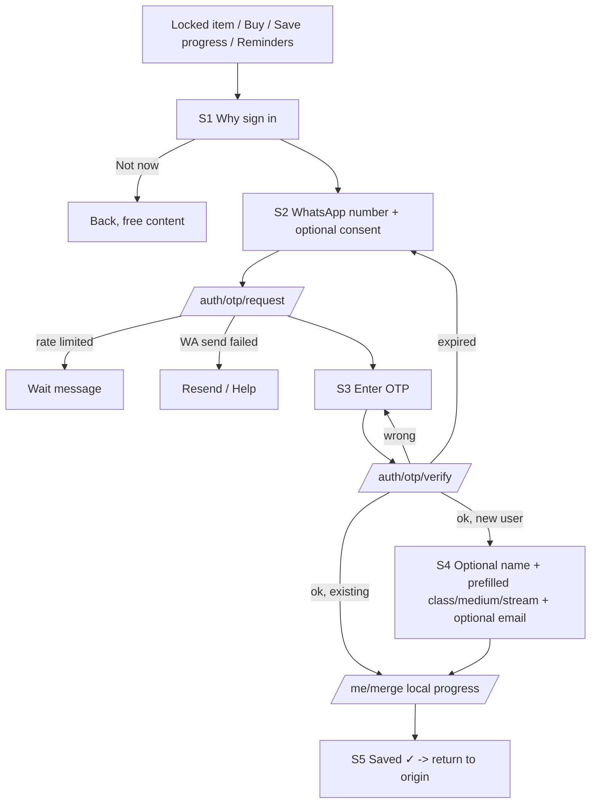
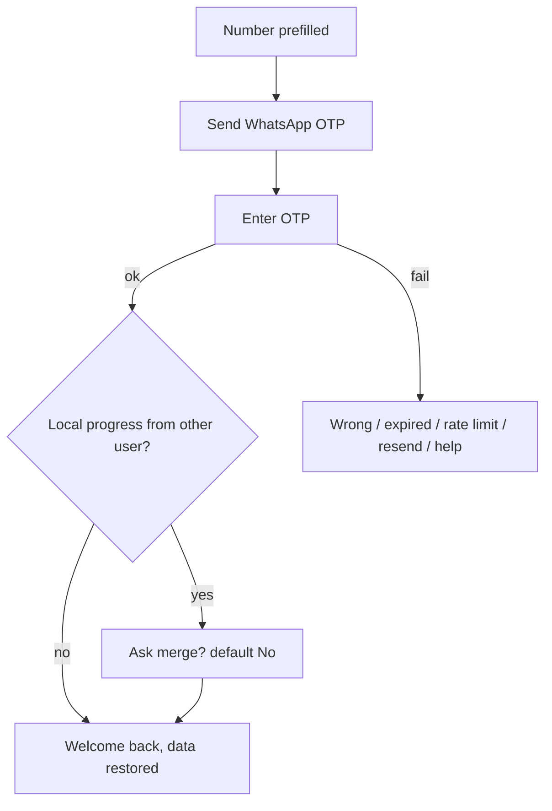
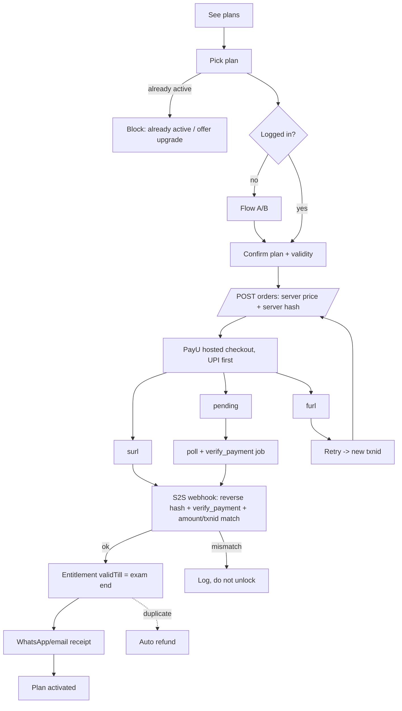

# BSEB Platform: User Flows (Account, Login, PayU Payment)
Login method: **WhatsApp number + WhatsApp OTP only**, sent with a WhatsApp Business API *authentication* template. There is no SMS OTP and no email OTP. Email is an optional field, used only for receipts.

## A. Account creation
**When it starts:** the student taps a locked item, taps "प्लान देखें → खरीदें", taps "सभी फ़ोन पर प्रगति सेव करें" in My Study, or turns on WhatsApp reminders or My Admit Card. Browsing free content never needs an account.

Screens:
1. **S1: Why sign in.** "अपना खाता बनाएँ / Create your account" with one line of explanation: "प्लान और प्रगति हर फ़ोन पर सुरक्षित रहेगी / Your plan and progress stay safe on any phone". Buttons: [WhatsApp नंबर से आगे बढ़ें / Continue with WhatsApp] and [अभी नहीं / Not now].
2. **S2: Number.** "अपना WhatsApp नंबर लिखें / Enter your WhatsApp number". +91 is fixed and the field takes 10 digits on the numeric keypad. Checkbox, **unticked by default**: "मुझे WhatsApp पर परीक्षा रिमाइंडर और पढ़ाई के संदेश चाहिए / Send me exam reminders and study messages on WhatsApp". Button: [OTP भेजें / Send OTP].
   - Errors: if the number is not 10 digits or does not start with 6–9, show "सही 10 अंकों का मोबाइल नंबर लिखें / Enter a valid 10-digit mobile number".
3. **S3: OTP.** "WhatsApp पर भेजा गया 6 अंकों का कोड लिखें / Enter the 6-digit code sent on WhatsApp". Six large boxes, plus "नंबर बदलें / Change number" and "दोबारा भेजें (0:30) / Resend in 0:30".
4. **S4: Name (optional).** "आपका नाम (वैकल्पिक) / Your name (optional)". Class, medium and stream are **pre-filled from the choices saved on the phone** and shown as chips with a "बदलें / Change" link. An optional email field is labelled "रसीद के लिए (वैकल्पिक) / For receipts (optional)". Button: [पूरा करें / Done].
5. **S5: Progress merged.** "आपकी पढ़ाई सेव हो गई ✓ / Your progress is saved". The student returns to the screen they came from, such as the locked item or checkout.

Backend:
1. `POST /auth/otp/request {phone}`: rate-limit, generate a 6-digit code, store **only its hash** with a 5-minute TTL, and send it with the WhatsApp authentication template (copy-code button).
2. `POST /auth/otp/verify {phone, code}`: allow at most 5 attempts per code. On success, create or upsert the user. Save the WhatsApp consent with a timestamp, source and template category. Issue a session (see B).
3. `POST /me/merge {localProgress, class, medium, stream, ref}`: merge with union/max rules, so the server's data is never overwritten by smaller local values. The call is idempotent.

Edge cases and messages:
- **WhatsApp not delivered** (provider error, or the number is not on WhatsApp): "OTP WhatsApp पर नहीं पहुँचा। नंबर जाँचें, WhatsApp खोलें और दोबारा भेजें। / OTP did not arrive on WhatsApp. Check the number, open WhatsApp and resend." Buttons: [दोबारा भेजें / Resend] and [मदद / Help] (opens the support WhatsApp chat, or a phone/email contact). **There is no SMS fallback.**
- **Wrong OTP:** "कोड गलत है, फिर से लिखें (बचे प्रयास: 3) / Wrong code, try again (3 tries left)".
- **Expired OTP:** "कोड की समय-सीमा खत्म, नया कोड मँगाएँ / Code expired, request a new one".
- **Rate limit** (3 sends per 10 minutes and 10 per day per number, with an IP limit too): "बहुत ज़्यादा प्रयास। 10 मिनट बाद कोशिश करें / Too many attempts. Try again in 10 minutes."
- **Number already has an account:** this becomes a login (flow B) and the local progress is merged silently.
- **Offline:** "इंटरनेट नहीं है / No internet". The number stays filled in and the student can retry.

## B. Login for returning users
1. **L1:** "लॉगिन करें / Log in" leads to the same WhatsApp number screen as S2. The last-used number is pre-filled and masked, e.g. "+91 98•••••210 से जारी रखें / Continue as +91 98•••••210".
2. **L2:** OTP screen, the same as S3, with a resend timer of 30 s, then 60 s, then 120 s.
3. **L3:** "वापसी पर स्वागत है / Welcome back". The student's plan and progress are restored.

Rules:
- **Session:** a refresh token in an httpOnly cookie (or secure storage) lasting **60 days, or until the plan's exam-end date plus 30 days**, whichever is longer, and an access token lasting 1 hour. Using the site slides the expiry forward.
- **New or shared phone:** after login, all server data is pulled. If the phone already holds local progress from someone else, ask: "इस फ़ोन की पिछली प्रगति आपके खाते में जोड़ें? / Add this phone's earlier progress to your account?" with [हाँ / Yes] and [नहीं / No]. The default is No.
- **Logout:** "लॉगआउट / Log out" (in My Study). Confirm with "क्या आप लॉगआउट करना चाहते हैं? / Log out?" Logging out clears the token and the admit-card cache from the phone, but keeps the class and medium choice. Also offer "सभी फ़ोन से लॉगआउट / Log out of all phones".
- **Errors:** the same wrong, expired, rate-limit and WhatsApp-failed messages as in A. When a session expires: "दोबारा लॉगिन करें / Please log in again", and the student is sent back to where they were afterwards.

## C. PayU payment
1. **P1: See plans.** "प्लान देखें / See plans". Three cards: मैट्रिक ₹149, इंटर ₹199, सभी ₹299. Each says "परीक्षा खत्म होने तक मान्य (दिनांक) / Valid till exam ends (date)". The card matching the student's class is highlighted.
2. **P2: Pick a plan.** Button: [₹149 में खरीदें / Buy for ₹149].
3. **P3: Login if needed.** Flow A or B runs, then the student returns to P4.
4. **P4: Confirm.** "आप खरीद रहे हैं: मैट्रिक प्लान ₹149, मान्य: 25 फ़र. 2027 तक / You are buying: Matric Plan ₹149, valid till 25 Feb 2027". Button: [UPI से भुगतान करें / Pay with UPI].
5. **Server creates the order:** `POST /orders {planId}`. The server reads the price from `plans.ts` on the server, never from the client. It creates a `txnid` and an order row with `status=created`, then computes the PayU **hash on the server**: sha512 of `key|txnid|amount|productinfo|firstname|email|udf1..udf5||||||SALT`. The salt never reaches the client. It returns the form fields.
6. **P5: PayU hosted checkout.** Auto-post to PayU with UPI first (`pg=UPI` / `enforce_paymethod` set so UPI intent and collect come first, with cards and net banking as further options).
7. **Return URLs:**
   - `surl`, success page: "भुगतान की पुष्टि हो रही है… / Confirming payment…"
   - `furl`, failure page: "भुगतान नहीं हुआ / Payment failed"
   - Pending page: "भुगतान प्रक्रिया में है / Payment pending"
   - **No return URL unlocks anything.** The server first verifies the reverse hash on the posted response, then confirms.
8. **S2S webhook plus verification:** handle PayU's server-to-server webhook by verifying the reverse hash (`SALT|status||||||udf5..udf1|email|firstname|productinfo|amount|txnid|key`). Also call PayU's **verify_payment API** for the `txnid`. Unlock only when status is `success` and the amount and txnid match the order. The webhook handler is idempotent and keyed on `txnid` / `mihpayid`.
9. **Unlock:** create `entitlement {userId, plan, validTill = examCalendar end date for that class (All Access = the later of the two)}`. **P6:** "प्लान चालू हो गया ✓ / Plan activated ✓". The student goes back to the locked item.
10. **Receipt:** a WhatsApp utility template "रसीद: मैट्रिक प्लान ₹149, Txn …, मान्य … तक", plus email if the student gave one. The receipt also appears in "मेरा प्लान / My plan".

Edge cases:
- **Pending UPI:** poll `/orders/:id` every 5 s for up to 2 minutes, while a background job calls verify_payment for 24 hours. Message: "अगर पैसे कट गए हैं तो चिंता न करें, पुष्टि होते ही प्लान चालू होगा / If money was deducted, don't worry. Your plan starts as soon as it is confirmed."
- **Failed payment:** "भुगतान असफल। पैसे नहीं कटे हों तो दोबारा कोशिश करें / Payment failed. Try again." Button: [फिर से भुगतान करें / Retry]. A retry creates a new txnid.
- **Double payment:** if the student already holds an active entitlement for the same or a higher plan, block the purchase on P2 with "यह प्लान पहले से चालू है / This plan is already active". If two payments succeed anyway, flag the second order `duplicate` and **refund it automatically** through the PayU refund API. Tell the student on WhatsApp.
- **Refund request:** "रिफंड के लिए अनुरोध / Request a refund" in My Plan, within the policy window (for example 7 days, configurable). The request is reviewed by an admin, then the PayU refund API is called, and the status is shown as requested, processing or refunded.
- **Upgrade to ₹299:** a student holding Matric (₹149) or Inter (₹199) sees "₹150 / ₹100 और देकर सभी प्लान लें / Upgrade to All Access for ₹150 / ₹100 more". The server computes the difference (299 minus the amount paid) and creates an `upgrade` order. On success the existing entitlement is replaced with All Access.
- **Plan expiry:** after `validTill`, locked items show again, with "आपका प्लान समाप्त हो गया / Your plan has ended". Reminders go out 7 days and 1 day before expiry (see section 17C).
- **Hash mismatch or tampering:** log a security event and never unlock. The student sees the pending message and support contact.

